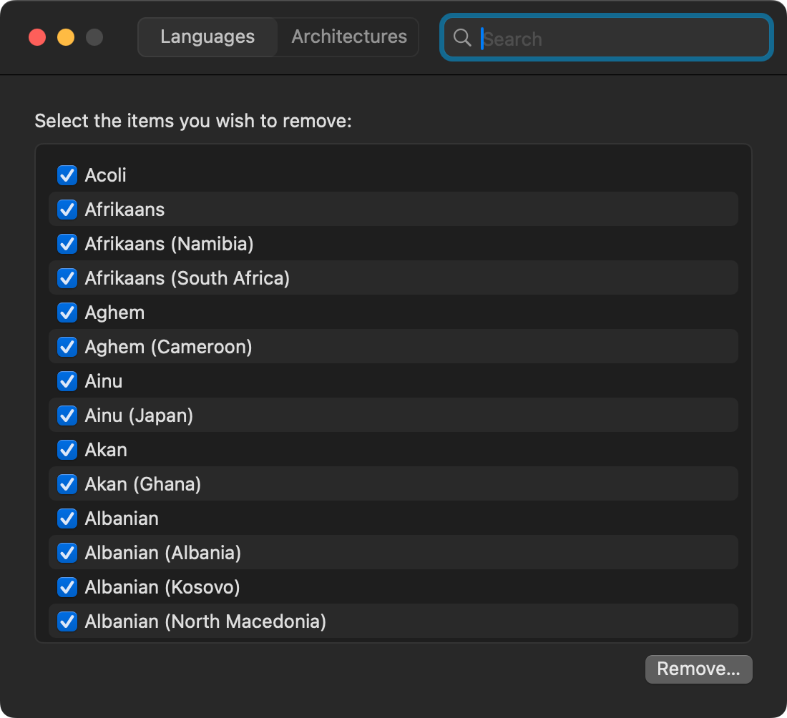

Monolingual
===========

#### A tool for removing unneeded language localization files for macOS

## About this version

This copy of Monolingual 2.0.2 differs from the upstream release:

- **It runs on macOS 15.6 and later** (Apple silicon) and builds with Xcode 26.3. Upstream requires macOS 27.
- **It never connects to the network.** There is no update mechanism (Sparkle is removed) and no download of the bundle blacklist; the blacklist bundled with the application is the one that applies.
- **It is in English only.**
- **It has its own identity.** The bundle identifier is `app.Monolingual` (the helper's is `app.Monolingual.Helper`), so it does not share settings or the helper's signing check with an upstream installation.
- **No third-party dependencies.** The helper's command-line options are parsed by the project's own code instead of swift-argument-parser.
- **AppKit lists.** The language and architecture lists are AppKit tables (`NSTableView`) rather than SwiftUI's `Table`, so they scroll smoothly.
- **Fixed-size window.** The main window is 550 × 450 points and cannot be changed.



## Installation and Usage

Monolingual is not signed with an Apple Developer ID and is not notarized. To launch it, you can either disable Gatekeeper, remove the quarantine flag manually with the command below (using the appropriate path for your installation, of course), navigate to System Settings > Privacy & Security and click "Open Anyway" after first attempting a launch, or build it yourself with Xcode (open `Monolingual.xcodeproj` in Xcode and choose Product > Build).

```sh
xattr -dr com.apple.quarantine "/Applications/Monolingual.app"
```

After the first launch, you must enable Monolingual in the "Allow in the Background" section of System Settings > General > Login Items & Extensions. This will require authentication with an administrator account because the background service must run as root. Please note that the background service is tied to the application's location, so place Monolingual in a permanent home (such as /Applications) before launching it.

## System Requirements and Security

- macOS 15.6.0 or later, Apple Silicon only.
- Uses Apple's Hardened Runtime, and is compliant with Swift 6 (Strict Concurrency and Strict Memory Safety); built against Xcode 26.3.
- No dependencies; the application, the helper, and the tests use only Apple's frameworks.

## Architecture

Monolingual consists of two parts: the Monolingual app and a privileged helper program that
is registered as a launch daemon with Service Management (`SMAppService`). Both are written in Swift and
communicate with each other using XPC.

An administrator has to allow the helper in System Settings › General › Login Items & Extensions
before it can run.

The helper checks that whoever connects to it is Monolingual. On macOS 26 and later, XPC enforces
that check for every session; on macOS 15 the helper sets a code signing requirement on each
connection through the C XPC API.

## Command-line Use

The privileged helper doubles as a command-line tool. Started without arguments, as launchd starts
it, it waits for requests from the app. Started with `--include`, it performs one removal and
exits, with no app involved:

```
Monolingual.app/Contents/MacOS/com.github.IngmarStein.Monolingual.Helper [options]
```

| Option | Meaning |
| --- | --- |
| `-v`, `--version` | Print the version and exit. |
| `-n`, `--dry-run` | List what would be removed or thinned without changing the file system. |
| `-s`, `--strip` | Strip debug information from executables. |
| `-t`, `--trash` | Move files to the Trash instead of deleting them. |
| `-i`, `--include <dir>` | A directory to process. Required for a command-line run. |
| `-x`, `--exclude <dir>` | A directory to leave alone, along with everything below it. |
| `-b`, `--bundle <id>` | A bundle identifier to leave alone (e.g. `com.apple.iPhoto`). |
| `-d`, `--delete <name>` | A file or directory name to remove (e.g. `fr.lproj`). |
| `-a`, `--thin <arch>` | An architecture to remove from universal binaries (e.g. `x86_64`). |
| `-h`, `--help` | Show the usage and exit. |

Each item removed is printed on a line of its own as `path: bytes`. In a dry run, the lines list
what a run would remove, with the space it would free; universal binaries a run would thin are
listed with 0 bytes, since what thinning saves is only known once it has run.

Options that take a value can be repeated, and accept `--name=value` as well as `--name value`.
Short options cannot be combined (`-n -s`, not `-ns`), and a value cannot begin with `-`. An unknown
option or a missing value prints an error and the usage, and exits with status 1. A run exits with
0 when it completes and 1 when it fails or is stopped.

Examples:

```bash
# See which French and German localizations under /Applications would go
Helper -n -i /Applications -d fr.lproj -d de.lproj

# Move them to the Trash instead, leaving one app alone
Helper -t -i /Applications -d fr.lproj -b com.example.SomeApp

# Remove the Intel slice from universal binaries in one folder
Helper -i ~/Applications -a x86_64
```

Here `Helper` stands for the full path above. The tool acts with the privileges of whoever runs
it: as yourself, it can only change what you can, and with `sudo` it can change anything SIP does
not protect. Always start with `-n`, because nothing a run deletes can be restored.

The project also builds a small standalone `lipo` (from `lipo/`, used by `swift test`):
`lipo <executables> --arch <architecture>` thins the given files in place, `--arch` can be repeated,
and it prints the bytes saved for each file.

## Contributors

### Main developer
Ingmar J. Stein

### Original idea
J. Schrier

### Artwork
Original icon by Matt Davey
New icon in 2.0.2 by [@fingers-piano](https://github.com/fingers-piano)

## License

GNU General Public License v3.0 only (GPL-3.0-only); the text is in [`COPYING`](COPYING).

This version: Copyright © 2026 avenged110. It is a modified version of Monolingual, Copyleft
2001, 2002 J. Schrier, 2004–2026 Ingmar Stein, which is released under the GNU General Public
License version 3. Files changed from upstream say so in their header; upstream's own notices are
kept as they were. See [`NOTICES/`](NOTICES).
